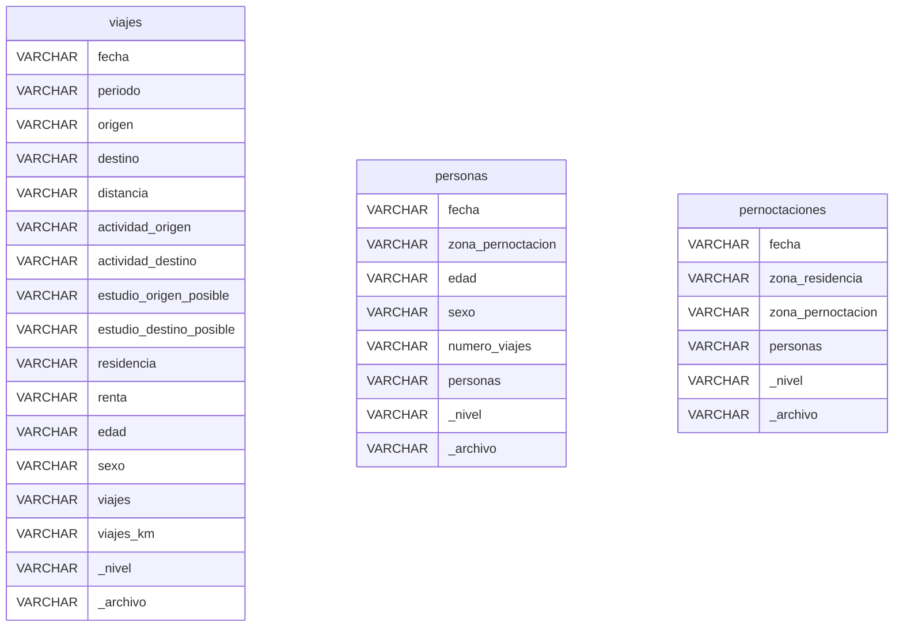
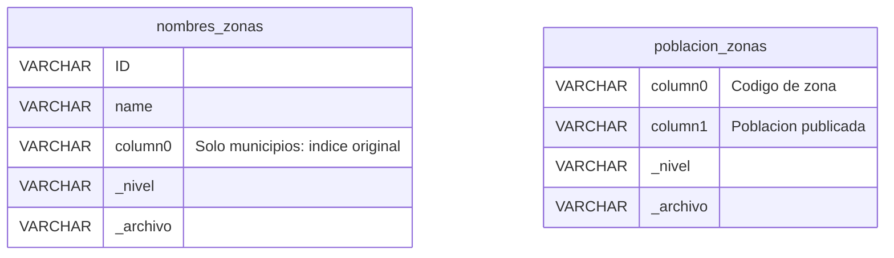
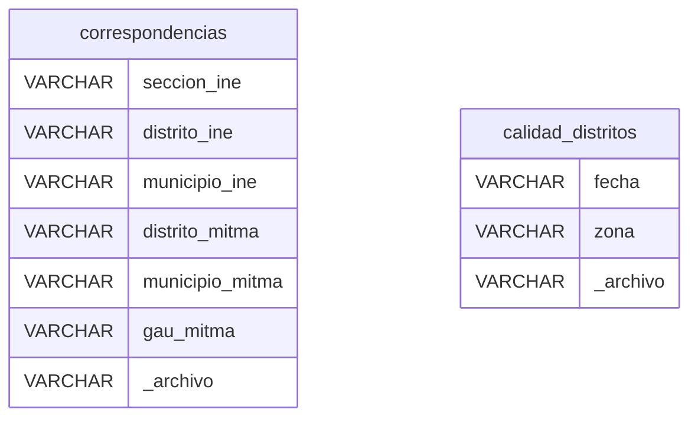
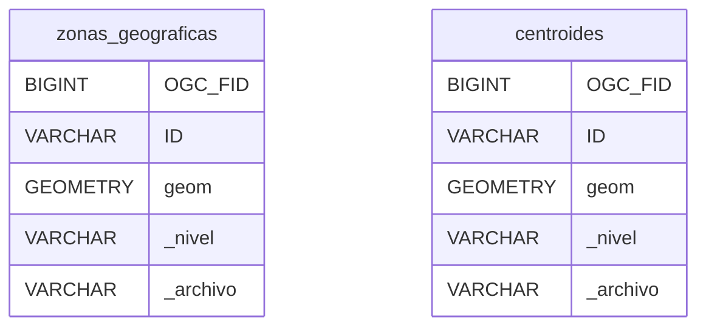

# Bronze

**Notebook:** [01_bronze.ipynb](../notebooks/01_bronze.ipynb).  
**Fuente:** archivos locales en `data/mitma/`; especificaciones en `LEEME_Especificaciones_indicadores_OpenDataMovilidad.xlsx` (pestañas EB).

## Esquema

### Movilidad

### Catálogos de zonas y población

### Correspondencias y calidad

### Geografía

## Fichas de los conjuntos

| Vista / tabla | Procedencia relativa a `data/mitma/` | Qué representa una fila |
|---|---|---|
| `viajes` | `por-{nivel}/viajes/diarios/*.csv.gz` | Viajes expandidos de un día, periodo horario, OD y combinación de distancia, actividades, estudio posible, provincia de residencia, renta, edad y sexo. |
| `personas` | `por-{nivel}/personas/diarios/*.csv.gz` | Personas de un día y zona de pernoctación, por edad, sexo y categoría de número de viajes. |
| `pernoctaciones` | `por-{nivel}/pernoctaciones/diarios/*.csv.gz` | Personas de un día por zona de residencia y zona de pernoctación publicadas. |
| `nombres_zonas` | `zonificación/zonificacion_{nivel}/nombres_*.csv` | Código y nombre de una zona. La columna inicial sin nombre de municipios se conserva como `column0`; en otros niveles se añade NULL estructural. |
| `poblacion_zonas` | `zonificación/zonificacion_{nivel}/poblacion_*.csv` | Zona y población auxiliar. Sin cabecera: nombres técnicos `column0` y `column1`. |
| `correspondencias` | `zonificación/relacion_ine_zonificacionMitma.csv` | Combinación de códigos INE/MITMA. No asumir una sección INE única por fila. |
| `calidad_distritos` | `calidad/diarios/*.csv` | Distrito descartado por fecha según MITMA. No contiene un registro por cada distrito válido. |
| `zonas_geograficas` | `zonificación/zonificacion_{nivel}/zonificacion_*.shp`, sin centroides | Polígono de una zona de distritos, municipios o GAU. Geometría original en EPSG:3042. |
| `centroides` | `zonificación/zonificacion_{nivel}/*_centroides.shp` | Centroide publicado de una zona. Geometría original en EPSG:3042. |

### Significado de los campos de movilidad

- `periodo`: hora de inicio, de `00` a `23`; para viajes que entran en España, hora de entrada según las especificaciones.
- `origen`, `destino`, `zona_pernoctacion`: códigos territoriales; no son necesariamente códigos INE de municipio.
- `zona_residencia`: código publicado en pernoctaciones; su correspondencia territorial requiere atención (ver hallazgos).
- `distancia`: rango de distancia ortodrómica en km, no distancia exacta entre centroides.
- `actividad_origen/destino`: casa, trabajo/estudio, actividad frecuente o no frecuente.
- `estudio_*_posible`: etiqueta que indica si la actividad puede ser educativa; se conserva la grafía publicada.
- `residencia`: provincia de residencia en viajes, distinta de la zona de residencia de pernoctaciones.
- `renta`: rango de renta en miles de euros. `edad` y `sexo`: segmentos publicados, con `NA` por privacidad en viajes.
- `viajes`: estimación expandida, admite decimales. `viajes_km`: viajes multiplicados por distancia ortodrómica; en desplazamientos externos solo se contabiliza la distancia nacional.
- `numero_viajes`: categoría `0`, `1`, `2`, `2+`; esta última significa más de dos, no permite calcular un total exacto de viajes.
- `personas`: medida publicada con decimales; no es un recuento de identificadores individuales.
