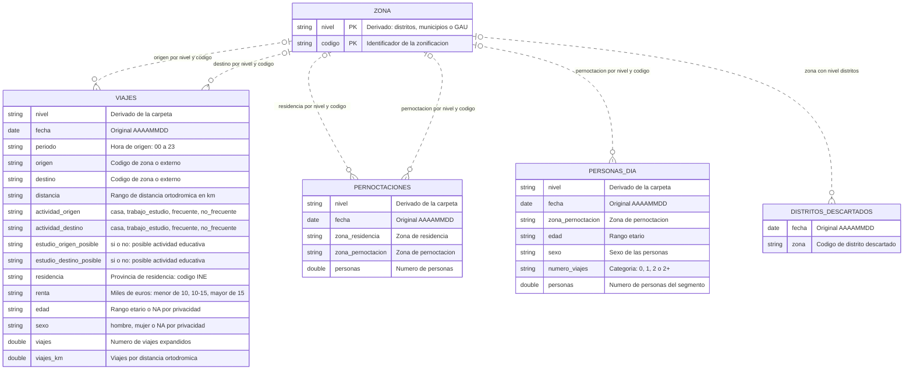
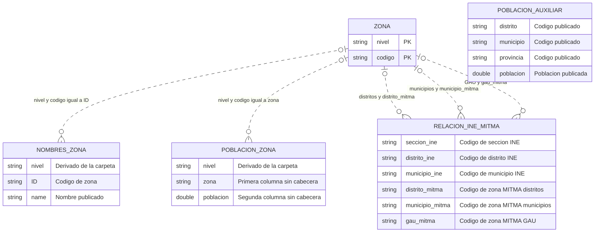

# Esquema de los datos MITMA disponibles

Fuente de las definiciones: [`LEEME_Especificaciones_indicadores_OpenDataMovilidad.xlsx`](../data/mitma/LEEME_Especificaciones_indicadores_OpenDataMovilidad.xlsx), hojas **EB - Viajes**, **EB - Pernoctaciones**, **EB - Personas** (distritos, municipios y GAU) y **EB - Distritos descartados**. Los campos de los CSV auxiliares se han contrastado con sus cabeceras.

## Alcance y lectura del diagrama

Este es un **esquema lógico de los archivos descargados**, no una propuesta completa de Bronze/Silver/Gold ni un esquema ya implementado en DuckDB.

- `VIAJES`, `PERNOCTACIONES` y `PERSONAS_DIA` representan cada una tres familias de archivos, con el mismo esquema para **distritos**, **municipios** y **GAU**.
- `nivel` es un **campo lógico derivado de la carpeta**, no una columna original. Evita confundir códigos iguales de zonificaciones distintas.
- `ZONA` es una **entidad lógica** que representa los códigos de cada zonificación; no existe un archivo `zona.csv`. Su clave conceptual es `(nivel, codigo)`.
- Las relaciones son referencias conceptuales, no restricciones verificadas. No se atribuyen claves primarias a los registros de indicadores sin comprobar su unicidad.
- Los tipos son **tipos de destino orientativos**: en los CSV todo está serializado como texto. Los códigos deben conservarse como texto y las medidas admiten decimales.

## 1. Indicadores de movilidad

La referencia a `ZONA` se muestra opcional porque la cobertura del catálogo no está validada y `VIAJES` admite el literal `externo`. Para imponer integridad referencial habría que tratar explícitamente ese valor por nivel.

### Correspondencia con los archivos

| Entidad | Ruta dentro de `data/mitma/` | Segmentación publicada, sin asumir unicidad |
|---|---|---|
| `VIAJES` | `por-{nivel}/viajes/diarios/AAAAMMDD_Viajes_{nivel}.csv.gz` | Fecha, hora, OD, distancia, actividades, indicadores educativos, residencia, renta, edad y sexo. |
| `PERNOCTACIONES` | `por-{nivel}/pernoctaciones/diarios/AAAAMMDD_Pernoctaciones_{nivel}.csv.gz` | Fecha, zona de residencia y zona de pernoctación. |
| `PERSONAS_DIA` | `por-{nivel}/personas/diarios/AAAAMMDD_Personas_dia_{nivel}.csv.gz` | Fecha, zona de pernoctación, edad, sexo y categoría de viajes realizados. |
| `DISTRITOS_DESCARTADOS` | `calidad/diarios/AAAAMMDD_distritos_descartados.csv` | Fecha y distrito descartado. |

`{nivel}` toma los valores `distritos`, `municipios` o `GAU`, respetando las mayúsculas de las rutas existentes.

## 2. Zonificación y población auxiliar

Este diagrama reproduce las columnas de los CSV auxiliares. `nivel` vuelve a ser derivado. Los nombres `zona` y `poblacion` de `POBLACION_ZONA` se asignan a sus dos columnas **sin cabecera**.

| Entidad | Archivo en `data/mitma/zonificación/` |
|---|---|
| `NOMBRES_ZONA` | `zonificacion_distritos/nombres_distritos.csv`, `zonificacion_municipios/nombres_municipios.csv`, `zonificacion_GAU/nombres_gaus.csv` |
| `POBLACION_ZONA` | `zonificacion_distritos/poblacion_distritos.csv`, `zonificacion_municipios/poblacion_municipios.csv`, `zonificacion_GAU/poblacion_gaus.csv` |
| `RELACION_INE_MITMA` | `relacion_ine_zonificacionMitma.csv` |
| `POBLACION_AUXILIAR` | `poblacion.csv` |

- El archivo `nombres_municipios.csv` incluye además una primera columna sin nombre, aparentemente un índice de exportación. No se considera una clave territorial y se omite del esquema lógico.
- `POBLACION_AUXILIAR` se deja sin relación explícita: su cabecera no basta para garantizar si sus códigos corresponden directamente a INE o MITMA. Hay que validar esa correspondencia antes del join.
- Las carpetas de zonificación también contienen shapefiles de polígonos y centroides, además de una zonificación especial para matrices de tiempos de viaje. No se inventan aquí sus atributos ni sus claves: requieren inspección específica. Los archivos `.dbf`, `.shx`, `.prj`, etc. son componentes auxiliares del shapefile, no indicadores independientes.

## 3. Reglas semánticas importantes

1. **No son microdatos de viajes individuales.** `viajes` es una medida expandida para la segmentación de cada fila; contar filas no equivale a contar viajes.
2. **Hora:** `periodo = '00'` identifica viajes con origen entre las 00:00:00 y las 00:59:59. Si el origen está fuera de España, se utiliza la hora de entrada en España.
3. **Distancia:** `distancia` es un rango de distancia ortodrómica: `0.5-2`, `2-10`, `10-50`, `>50`. No es distancia por carretera ni una distancia numérica exacta.
4. **Viajes-km:** el Excel lo define como viajes por distancia ortodrómica. Para viajes con origen o destino fuera de la zonificación, solo se contabiliza la distancia en territorio nacional. No debe calcularse multiplicando por un punto medio arbitrario del rango `distancia`.
5. **Residencia:** en `VIAJES` es una **provincia INE**; en `PERNOCTACIONES`, `zona_residencia` es una **zona del nivel correspondiente**. No son claves intercambiables.
6. **Renta:** los rangos están expresados en **miles de euros**. La descripción consultada no concreta periodicidad ni unidad individual/hogar: no se añaden esas suposiciones.
7. **Privacidad:** en viajes, `edad = 'NA'` o `sexo = 'NA'` significa que la información no se facilita por criterios de privacidad. No representa cero ni debe eliminarse automáticamente al sumar viajes.
8. **Discrepancia de edad:** el Excel describe `0-24`, `25-44`, `45-64`, `>65`, pero la muestra local de viajes contiene `0-25`, `25-45`, `45-65`, `65-100`. Se debe conservar el valor original y resolver los límites antes de homologar categorías; no basta con cambiar las etiquetas.
9. **Categoría de viajes:** `PERSONAS_DIA.numero_viajes` no es una medida continua. Según el Excel, `2+` significa **más de dos viajes**, mientras que `2` tiene su propia categoría.
10. **Evitar doble conteo:** no sumar distritos, municipios y GAU como poblaciones independientes. Tampoco unir directamente tablas de indicadores con distintos granos: agregar primero al grano común para evitar multiplicar medidas.
11. **Correspondencias territoriales:** `RELACION_INE_MITMA` sirve como puente de códigos. Puede tener varias filas por zona MITMA; un join directo puede duplicar los indicadores. Extraer y validar las correspondencias necesarias antes de agregar entre niveles.
12. **Calidad:** los distritos descartados identifican zonas excluidas; no deben interpretarse como zonas con movilidad cero.

El Excel también documenta registros de red, muestra, estadísticos semanales, estudios completos y rutas. No aparecen como tablas de indicadores en este esquema porque esos archivos no están descargados actualmente en `data/`.
