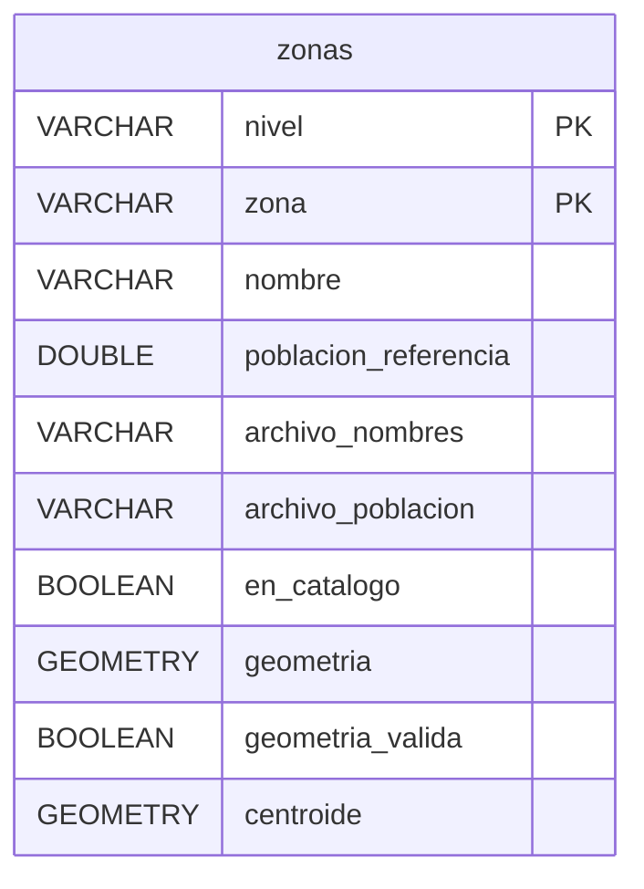
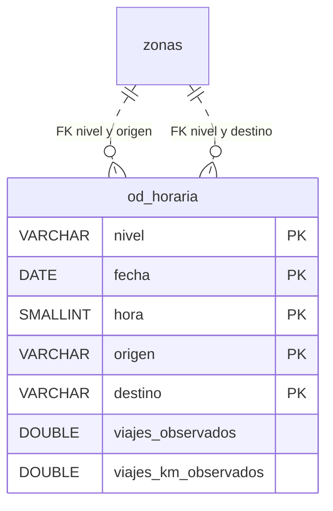
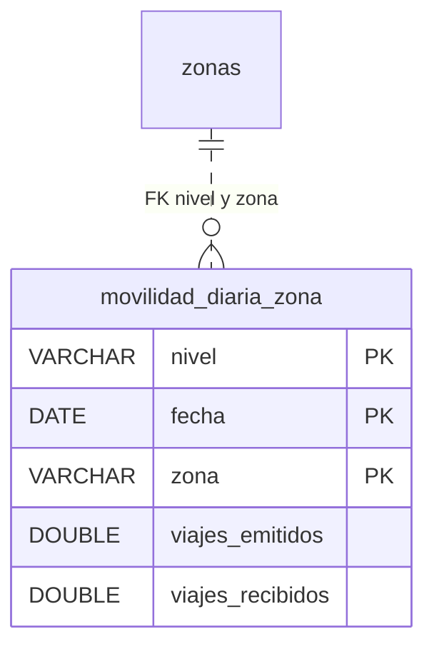

# Gold — productos analíticos MITMA

**Notebook:** [03_gold.ipynb](../notebooks/03_gold.ipynb).  

## Esquema

### Catálogo de zonas

### Flujos horarios

### Movilidad diaria

`zonas` en los distintos bloques representa la misma tabla del catálogo; sus campos se muestran solo en el primero.

## Fichas de los conjuntos

| Tabla | Procedencia | Qué representa una fila |
|---|---|---|
| `od_horaria` | `silver.viajes` | Viajes publicados entre un origen y un destino, para un nivel, fecha y hora. |
| `movilidad_diaria_zona` | `gold.od_horaria` | Viajes emitidos y recibidos por una zona, para un nivel y fecha. |
| `zonas` | `silver.zonas` y `silver.geografia_zonas` | Zona con atributos y geografía opcional, usada como destino de las FK de Gold. |
| `mapa_movilidad_diaria` (vista) | `gold.movilidad_diaria_zona` y `gold.zonas` | Totales diarios de una zona con nombre, polígono y centroide disponibles para mapas. |

## Significado de las medidas

- `viajes_observados`, `viajes_km_observados`: totales publicados de viajes y viajes-km para cada grupo horario.
- `viajes_emitidos`, `viajes_recibidos`: viajes diarios que salen de la zona o llegan a ella, respectivamente.

Las sumas omiten los valores `NULL`; si todas las medidas de un grupo son nulas, su total es `NULL`. Estas tablas no conservan contadores de filas ni de medidas ausentes, por lo que un total no nulo puede ser parcial. Para comprobar esas ausencias hay que consultar Silver. Los días o flujos no publicados no se completan con ceros, y no se deben sumar los distintos niveles territoriales entre sí.

## Ejemplos del notebook

- **Perfil horario:** primero se muestran las fechas y horas disponibles. Para municipios se suman los viajes por fecha y hora y después se calcula la media por día de la semana (1=lunes, 7=domingo) y hora. Así cada día aporta un total, sin ponderarlo por su número de pares origen-destino. `dias_con_filas` cuenta los días con flujos para esa hora; `dias_con_medida`, los que tienen un total no nulo. La media excluye los totales nulos, pero no detecta los parciales. Con la muestra inicial solo describe el domingo 1 de enero de 2023.
- **Datos para un mapa:** la vista `mapa_movilidad_diaria` une los viajes emitidos y recibidos con los atributos geográficos por `(nivel, zona)`. Conserva las zonas sin polígono, con `geometria=NULL`. La consulta final cuenta las filas zona-día y cuántas tienen geometría por nivel; una misma zona puede aparecer en varias fechas.
