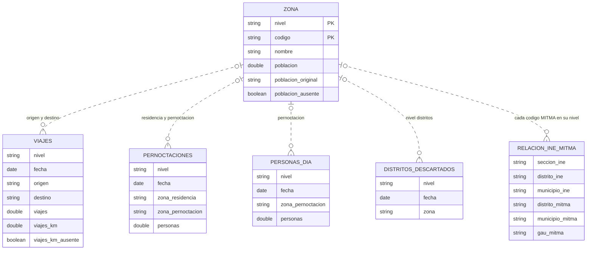

# MITMA: modelo Bronze y Silver

## Alcance

Diseño del primer sprint, apoyado en [la exploración ejecutada](../notebooks/exploratory.ipynb)
y en el [diccionario y esquema de origen](esquema_datos_mitma.md).
Se estudian viajes, pernoctaciones, personas por día, calidad y auxiliares territoriales.
Los datos diarios locales corresponden al **01/01/2023**, en distritos, municipios y GAU:
no permiten validar tendencias ni estabilidad del esquema en otras fechas.

El notebook implementa un **prototipo de vistas Silver en DuckDB en memoria** para los
tres indicadores y del catálogo territorial. Este documento define el contrato propuesto para el resto de tablas;
no hay todavía pipeline, almacenamiento Silver persistente ni capa Gold.

## 1. Bronze: archivos originales

Bronze es el contenido actual de `data/mitma/`, conservado **byte a byte**: mismos nombres,
carpetas, compresión, cabeceras y valores. No se sustituyen los CSV por Parquet, no se
añaden columnas al original y no se eliminan duplicados. Una futura carga debe evitar
sobrescribir versiones y registrar procedencia y checksum en un manifiesto separado.

### Esquema físico

Rutas relativas a `data/mitma/`; `{nivel}` = `distritos`, `municipios`, `GAU` y
`{sufijo}` = `distritos`, `municipios`, `gaus`, respectivamente.

| Familia | Ruta / formato | Columnas publicadas, en orden |
|---|---|---|
| Viajes | `por-{nivel}/viajes/diarios/AAAAMMDD_Viajes_{nivel}.csv.gz` | `fecha, periodo, origen, destino, distancia, actividad_origen, actividad_destino, estudio_origen_posible, estudio_destino_posible, residencia, renta, edad, sexo, viajes, viajes_km` |
| Pernoctaciones | `por-{nivel}/pernoctaciones/diarios/AAAAMMDD_Pernoctaciones_{nivel}.csv.gz` | `fecha, zona_residencia, zona_pernoctacion, personas` |
| Personas por día | `por-{nivel}/personas/diarios/AAAAMMDD_Personas_dia_{nivel}.csv.gz` | `fecha, zona_pernoctacion, edad, sexo, numero_viajes, personas` |
| Calidad | `calidad/diarios/AAAAMMDD_distritos_descartados.csv` | `fecha, zona` |
| Nombres | `zonificación/zonificacion_{nivel}/nombres_{sufijo}.csv` | `ID, name`; municipios incluye antes una columna sin nombre |
| Población por zona | `zonificación/zonificacion_{nivel}/poblacion_{sufijo}.csv` | Dos columnas **sin cabecera**: código y población |
| Puente INE–MITMA | `zonificación/relacion_ine_zonificacionMitma.csv` | `seccion_ine, distrito_ine, municipio_ine, distrito_mitma, municipio_mitma, gau_mitma` |
| Población auxiliar | `zonificación/poblacion.csv` | `distrito, municipio, provincia, poblacion` |
| Geografía | Carpetas de `zonificación/`: polígonos, centroides y zonificación especial | Cada shapefile y sus componentes se conservan juntos; atributos aún no perfilados |
| Documentación | Excel de especificaciones y PDF de licencia | Se conservan como documentación de fuente, no como tablas de indicadores |

Los CSV usan `|`. Para explorarlos: `all_varchar=true`, `nullstr='__NULL_NO_PUBLICADO__'`
y `header=false` solo para población por zona. Esta es una **política de lectura**,
no una transformación de Bronze. Evita perder ceros iniciales o convertir `NA` y vacíos
en nulos. `nivel` y `archivo_origen` no existen en estos archivos: se derivan al leer.

**Manifiesto futuro, separado:** ruta, URL de origen si se conoce, instante de descarga,
tamaño y SHA-256. No se inventan fechas de descarga ni URL a partir de los archivos locales.

## 2. Silver: tablas tipadas, sin cambiar la granularidad

Se mantienen los indicadores separados. No se agregan horas ni segmentos, no se suman
niveles y no se normaliza cada categoría en una dimensión adicional en este sprint.

### Convenciones

- `nivel VARCHAR`: `distritos`, `municipios` o `GAU`, derivado de la ruta.
- Códigos `VARCHAR`, incluso si solo contienen dígitos; nunca se unen por nombre.
- `fecha DATE`, parseada de `AAAAMMDD`; no es un entero para operaciones aritméticas.
- Medidas `DOUBLE`: son estimaciones expandidas con decimales, no conteos enteros.
- `archivo_origen VARCHAR`: ruta relativa a Bronze, para trazabilidad en todas las tablas.
  En `zona` se usan dos columnas, `archivo_nombres` y `archivo_poblacion`.
- Se conservan `NA` y las etiquetas originales. Vacío, supresión y error de conversión
  son situaciones distintas. No se sustituyen por cero.
- Excepción explícita de tipado: `viajes_km = ''` pasa a `NULL` y se añade
  `viajes_km_ausente BOOLEAN`. No se conoce el motivo de esos vacíos; no se les atribuye
  privacidad. La marca y la procedencia permiten distinguirlos de un cero publicado.
- En población, el literal `NA` pasa a `NULL` numérico, conservando
  `poblacion_original VARCHAR` y `poblacion_ausente BOOLEAN`. No es población cero.
- Las claves de indicadores que siguen son **candidatas**, sujetas a controles en cada carga.
  `archivo_origen` no forma parte de la clave de negocio: dos archivos no deben duplicar el mismo segmento.

### Indicadores

Todas estas tablas incluyen `nivel` y `archivo_origen` además de las columnas indicadas.

| Tabla | Columnas y tipos | Grano / clave candidata |
|---|---|---|
| `viajes` | `fecha DATE`; `periodo, origen, destino, distancia, actividad_origen, actividad_destino, estudio_origen_posible, estudio_destino_posible, residencia, renta, edad, sexo VARCHAR`; `viajes, viajes_km DOUBLE`; `viajes_km_ausente BOOLEAN` | `nivel` + todas las columnas publicadas salvo `viajes, viajes_km` |
| `pernoctaciones` | `fecha DATE`; `zona_residencia, zona_pernoctacion VARCHAR`; `personas DOUBLE` | `(nivel, fecha, zona_residencia, zona_pernoctacion)` |
| `personas_dia` | `fecha DATE`; `zona_pernoctacion, edad, sexo, numero_viajes VARCHAR`; `personas DOUBLE` | `(nivel, fecha, zona_pernoctacion, edad, sexo, numero_viajes)` |
| `distritos_descartados` | `fecha DATE`; `zona VARCHAR` | `(nivel, fecha, zona)`; `nivel = 'distritos'` |

El prototipo del notebook llama `silver_personas` a la vista de `personas_dia`.
`periodo` permanece como texto `00`–`23`, para conservar la representación publicada.
Los indicadores educativos siguen como categorías `si/no`, sin convertir etiquetas desconocidas en `false`.

### Territorio y auxiliares

| Tabla | Columnas y tipos | Regla |
|---|---|---|
| `zona` | `nivel, codigo, nombre, poblacion_original VARCHAR`; `poblacion DOUBLE`; `poblacion_ausente BOOLEAN`; `archivo_nombres, archivo_poblacion VARCHAR` | Clave `(nivel, codigo)`. Unir nombres y población por esa clave tras comprobar unicidad. Conservar faltantes como nulos, sin inventar población ni nombres. |
| `relacion_ine_mitma` | `seccion_ine, distrito_ine, municipio_ine, distrito_mitma, municipio_mitma, gau_mitma, archivo_origen VARCHAR` | Correspondencia al detalle publicado. No tiene un único `nivel`, pues enlaza varios. No asumir una fila por zona MITMA. |
| `poblacion_auxiliar` | `distrito, municipio, provincia, archivo_origen, poblacion_original VARCHAR`; `poblacion DOUBLE`; `poblacion_ausente BOOLEAN` | Conservar separada. La coincidencia de códigos no demuestra por sí sola su semántica, referencia temporal ni equivalencia con población por zona. Sin FK ni clave primaria impuesta por ahora. |

`zona` se construye desde los auxiliares, no desde un producto cartesiano de niveles y códigos.
`externo` se conserva en los hechos y **no se inventa una zona geográfica** para él.
Las referencias son opcionales hasta validar todos los códigos; las ausencias se reportan.
En particular, la residencia de pernoctaciones en municipios y GAU no tiene cobertura
completa en su catálogo: la relación del diagrama es una intención lógica, **no una FK
validada**. Se conserva el código original y queda pendiente confirmar su zonificación.
La población auxiliar no se suma a la de `zona`: podría duplicar el mismo concepto.
No se asigna a los auxiliares una fecha de referencia inexistente en los CSV.
En el puente se conserva el literal `NA` de códigos INE, pero nunca se utiliza como
clave de sección en un join: agruparía territorios diferentes sin sección identificada.

### Relaciones

Diagrama resumido; las tablas anteriores son el diccionario completo. Las líneas indican
referencias por `(nivel, codigo)`, no restricciones físicas ya instaladas.

## 3. Transformaciones y controles de carga

1. Inventariar Bronze y leer con el delimitador, cabecera y política de texto explícitos.
2. Añadir nivel y procedencia. Verificar esquema y coincidencia entre fecha del archivo y columna.
3. Perfilar valores originales; validar fecha, medidas finitas y no negativas antes del cast.
   Ausencias conocidas: vacío de `viajes_km` y literal `NA` de población.
4. Convertir fechas y medidas. Aplicar `CAST(NULLIF(viajes_km, '') AS DOUBLE)` y generar
   su marca de ausencia desde el texto original. Conservar categorías, códigos y medidas publicadas.
   Para población: `CAST(NULLIF(poblacion, 'NA') AS DOUBLE)`, texto original y marca.
5. Validar granularidad y unicidad. Si se repite una clave, investigar; **no sumar ni borrar automáticamente**.
6. Validar claves auxiliares, cobertura y cardinalidades antes de construir `zona` o extraer puentes.
7. Comparar filas, ausencias y sumas Bronze/Silver **por familia, medida y nivel**, con tolerancia numérica para `DOUBLE`.
   Nunca comparar mediante una suma conjunta de los tres niveles.

En el notebook las conversiones finales usan `CAST` y `strptime` estrictos; `TRY_CAST`
solo diagnostica. Una carga futura debe detenerse o aislar errores con motivo y procedencia,
no convertirlos silenciosamente en NULL. Los `NULL` de `viajes_km` siguen la regla explícita
anterior: las sumas de esa columna cubren solo los valores conocidos, no un total completo.
Lo mismo ocurre con las poblaciones ausentes. El prototipo de `silver_zona` muestra
el tipado y la unión de atributos; las dos rutas de procedencia quedan por incorporar
en su futura materialización.
Los controles de perfil del notebook son diagnósticos;
no constituyen todavía un sistema de cuarentena ni de validación de producción.

Para unir indicadores con otra zonificación se extraen primero pares `DISTINCT` del puente
y se verifica cuántos destinos tiene cada origen. No se elige arbitrariamente el primero
ni se distribuyen medidas sin una regla de asignación validada. Tampoco se unen directamente
viajes, personas y pernoctaciones: antes deben agregarse al grano común requerido.

## 4. Hallazgos que justifican el modelo

Resultados de los archivos locales; los bloques del notebook permiten reproducirlos.

| Evidencia | Decisión Silver |
|---|---|
| `viajes_km` contiene 640 vacíos en municipios y 466 en GAU; ninguno en distritos. No hay medidas no vacías no convertibles, no finitas o negativas en las tres familias. | Columna nullable con marca de ausencia; no rellenar con cero ni reconstruir kilómetros. Otros valores inválidos deben bloquear una carga. |
| Viajes de distritos tiene 513 claves de segmentación repetidas y 551 filas excedentes; solo hay un grupo de duplicación exacta, con una fila excedente. Pernoctaciones y personas por día no repiten sus claves candidatas en ningún nivel. | No imponer PK de segmento en viajes ni deduplicar automáticamente: las repeticiones de dimensiones no son todas copias idénticas. Mantener filas hasta resolver su interpretación. |
| El 38,10 % de la medida de viajes tiene edad o sexo `NA`, en cada nivel. | Mantener las categorías de privacidad: eliminarlas alteraría sustancialmente el total. |
| Nombres y población tienen 3.792 claves en distritos, 2.618 en municipios y 2.086 en GAU; únicas y con cobertura mutua completa. | Se pueden reunir en `zona` por `(nivel, codigo)`, sin multiplicar filas. Validar de nuevo al actualizar los auxiliares. |
| Cada archivo de población por zona y población auxiliar contiene 49 valores `NA`. | Población nullable con texto original y marca; no interpretar la ausencia como error numérico ni como cero. |
| Viajes contiene 109 códigos de origen y 111 de destino fuera del catálogo por nivel, además de `externo`. Pernoctaciones tiene 1.596 códigos de residencia fuera del catálogo en municipios y 1.981 en GAU; ninguno en distritos. | No imponer integridad referencial ni remapear códigos por coincidencia textual. Mantener hechos y revisar códigos externos y zonificación de residencia. |
| Los nueve distritos descartados están en el catálogo y no aparecen como origen ni destino de viajes de distritos ese día. | Conservar la tabla de calidad; ausencia de filas no significa cero viajes. |
| El puente tiene 36.382 filas y 36.334 valores distintos de sección, contando `NA`. Hay 49 filas con sección `NA`; las otras 36.333 secciones son únicas. No hay duplicados exactos. | No declarar `seccion_ine` como PK global ni eliminar las 49 filas; conservar el puente y excluir `NA` como clave de sección al enlazar. |
| Una zona tiene hasta 200 filas del puente en distritos, 2.443 en municipios y 4.141 en GAU. Los pares distrito MITMA → municipio MITMA y municipio MITMA → GAU tienen un único destino por origen en esta versión. | Extraer pares distintos antes del join; no unir los hechos directamente con el puente al detalle de sección. |
| Población auxiliar tiene 3.792 distritos, con los mismos códigos y valores de población que el auxiliar de distritos. | Evitar contar ambos conjuntos como poblaciones diferentes. Mantener el auxiliar separado hasta validar su semántica y referencia temporal. |

Entre los códigos de viajes sin catálogo aparecen `FR101`, `FR102`, etc.; `externo` no
es la única representación de un territorio fuera del catálogo nacional. En residencia
de pernoctaciones de GAU aparecen códigos como `0105901`. No se reasignan a otro nivel
sin confirmar la definición de esa columna y su correspondencia.

La reconciliación del prototipo conserva filas, ausencias y sumas conocidas por familia
y nivel. Estas comprobaciones no demuestran que los indicadores sean intercambiables:
los totales de personas por día y pernoctaciones no coinciden exactamente.

## 5. Precauciones semánticas

- `SUM(viajes)` mide viajes; `COUNT(*)` mide segmentos publicados.
- `distancia` es una banda ortodrómica, no distancia por carretera. No recalcular `viajes_km`
  con puntos medios de intervalos.
- `viajes.residencia` es provincia INE, no una FK directa a `zona`.
- `NA` en edad/sexo de viajes indica privacidad: eliminar esas filas sesgaría los totales.
- Conservar las edades locales `0-25`, `25-45`, `45-65`, `65-100`; no renombrarlas a los
  intervalos del Excel sin aclarar sus límites.
- `numero_viajes = '2+'` significa más de dos viajes; no es una medida continua.
- Un distrito descartado no equivale a movilidad cero. La lista de calidad se conserva
  aparte; no se fabrican filas de hechos con ceros.
- La geografía, la temporalidad de población y la semántica de población auxiliar quedan
  pendientes de validación específica. No se prometen geometrías ni relaciones no inspeccionadas.
