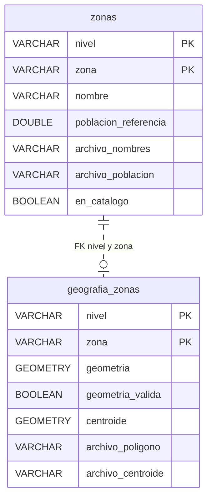
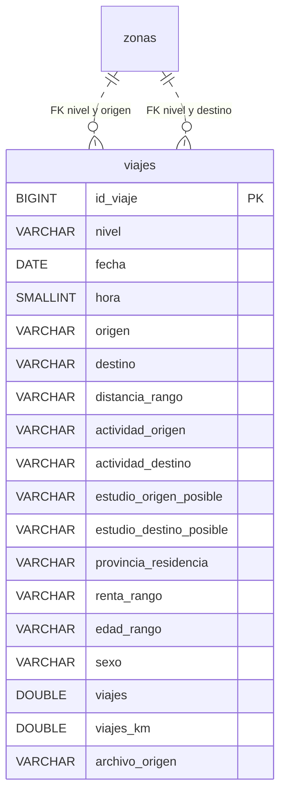
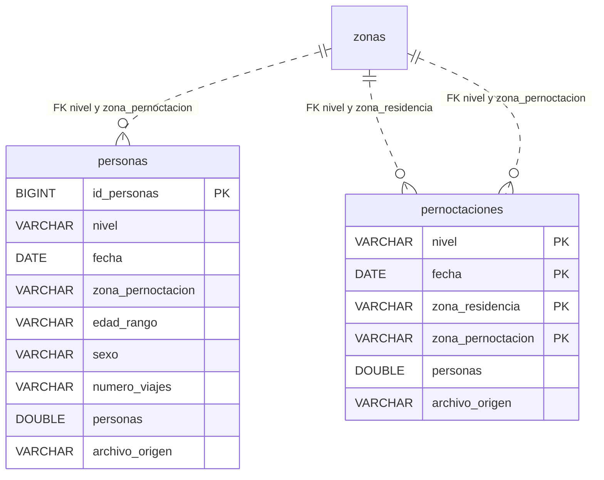
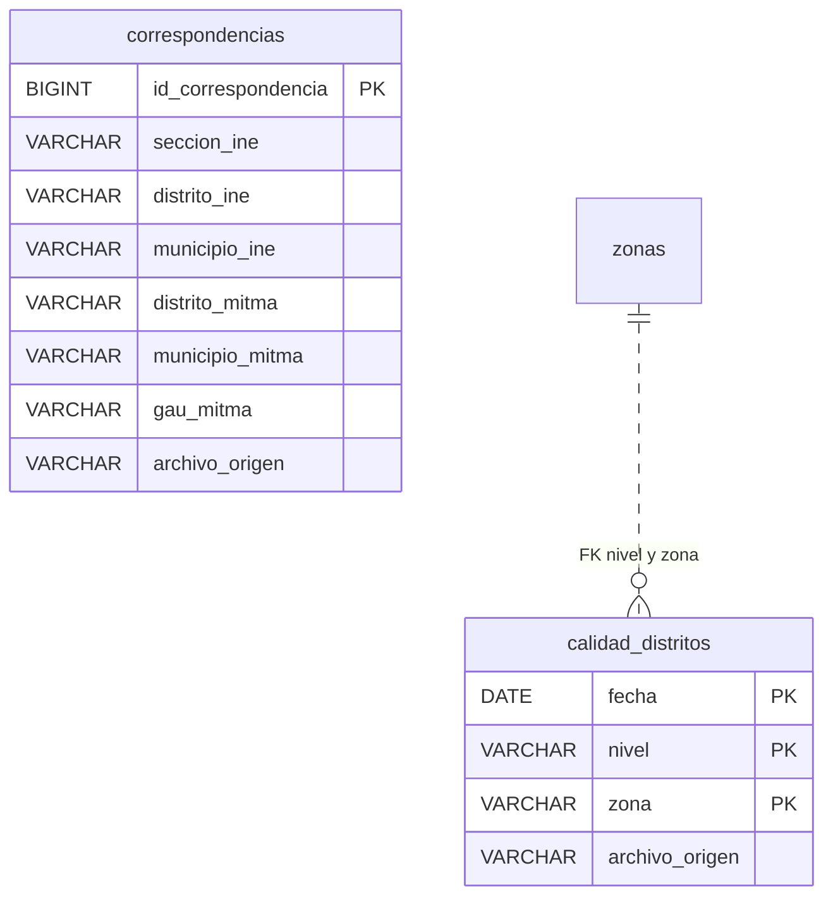

# Silver

**Notebook:** [02_silver.ipynb](../notebooks/02_silver.ipynb).  
**Persistencia:** tablas en el esquema `silver` de `data/processed/mitma.duckdb`.

## Esquema

### Catálogo y geografía

### Viajes

### Personas y pernoctaciones

### Correspondencias y calidad

`zonas` en los distintos bloques representa la misma tabla del catálogo; sus campos se muestran solo en el primero.

## Fichas de los conjuntos

| Tabla | Procedencia | Qué representa una fila |
|---|---|---|
| `viajes` | `bronze.viajes` | Registro de viajes por nivel, fecha, hora, origen, destino y desgloses originales. La PK artificial distingue registros aunque sus desgloses coincidan. |
| `personas` | `bronze.personas` | Personas por nivel, fecha, zona de pernoctación, edad, sexo y categoría de número de viajes. |
| `pernoctaciones` | `bronze.pernoctaciones` | Personas por nivel, fecha, zona de residencia y zona de pernoctación publicadas. |
| `zonas` | `bronze.nombres_zonas` y `bronze.poblacion_zonas` | Una zona por nivel, con nombre y población auxiliar cuando estén disponibles. |
| `correspondencias` | `bronze.correspondencias` | Combinación de códigos INE y MITMA. Una sección INE no identifica por sí sola una fila. |
| `calidad_distritos` | `bronze.calidad_distritos` | Distrito incluido en la lista de descartados para una fecha. |
| `geografia_zonas` | `bronze.zonas_geograficas` y `bronze.centroides` | Polígono y centroide disponibles para una zona y nivel, en EPSG:4326. |

## Campos propios de Silver

- `nivel` y `archivo_origen`: nivel territorial y procedencia del registro.
- `hora`: periodo horario del viaje, de 0 a 23.
- `distancia_rango`, `renta_rango`, `edad_rango`: categorías publicadas, no valores exactos.
- `provincia_residencia`: provincia de residencia en viajes; no es una zona de origen o destino.
- `poblacion_referencia`: población auxiliar sin año de referencia confirmado. `archivo_nombres` y `archivo_poblacion` identifican sus dos fuentes.
- `en_catalogo`: indica si el código figura en los auxiliares de nombres o población. Los demás códigos se conservan sin inventar atributos.
- `id_viaje`, `id_personas`, `id_correspondencia`: identificadores de fila generados en la carga; no son estables entre cargas ni identifican personas reales.
- `geometria`, `centroide`: longitud y latitud para mapas; no usar grados como distancia. `geometria_valida` señala polígonos que requieren revisión antes de ciertas operaciones espaciales.

El significado de los campos originales se recoge en [Bronze](bronze.md). Las transformaciones y comprobaciones se explican junto al código del notebook.
